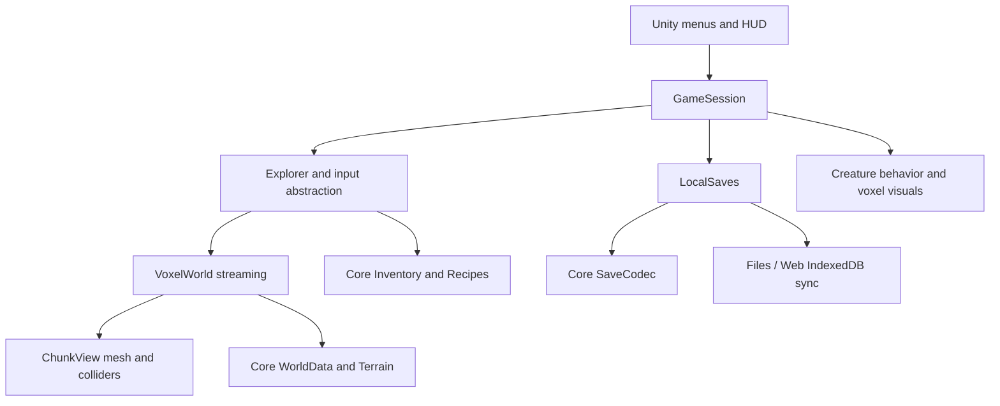

# Audit and architecture

## Workspace audit — 2026-10-11

- `E:\GAME` was empty, including hidden entries. There was no aircraft game, Git repository, `AGENTS.md`, Unity scene, package manifest, or controller to preserve/reuse.
- E: was searched for `Unity.exe` and `ProjectVersion.txt` after the user identified E: as the installation drive. Neither was found. E: contained `GAME`, `$RECYCLE.BIN`, and `System Volume Information`.
- Standard Unity Hub/Editor locations and Unity registry information also did not reveal an installation.
- Available: PowerShell 5.1, Node.js, Git, .NET Framework C# compiler. The `dotnet` command exists but reports no installed SDK.
- All three provided PNGs were copied, not moved. The attached brief was read as the user's task. No instructions were taken from the image artwork.
- New project is isolated in `CubeFrontier/`. No existing game was modified.

## Boundaries

`Core` has no Unity dependency and can be compiled independently. `Runtime` owns engine-specific input, presentation, physics and persistence. `Editor/ProjectSetup` creates render assets and configures the build. The scene's only serialized component is `GameSession`; it constructs runtime objects. Stable scene/script reference metadata is committed.

World coordinates use floor division, including negative chunks. Procedural base chunks are immutable caches; edits overlay them. Returning a cell to its generated value removes its save delta. Face extraction samples neighbors across chunk borders, including a data halo. Collision geometry excludes water. Meshes are disposed when chunks unload.

The source uses Unity's legacy desktop input behind `IPlayerInput`. Project preparation selects that input backend. Touch is not implemented. CharacterController handles movement/collision; transform repositioning is limited to loading and respawning.

## Engine/package choice

Unity **6000.3.25f1** was selected from the [official release page](https://unity.com/releases/editor/whats-new/6000.3.25f1). URP **17.3.0** is specified for Unity 6000.3, consistent with the [official Graphics changelog](https://github.com/Unity-Technologies/Graphics/blob/master/Packages/com.unity.render-pipelines.universal/CHANGELOG.md) and [URP API](https://docs.unity.cn/Packages/com.unity.render-pipelines.universal%4017.3/api/UnityEngine.Rendering.Universal.UniversalRenderPipelineAsset.html). These are source configuration choices, not locally verified imports. A raw public package-registry query exposed only older URP versions; actual bundled-package resolution must be checked in the Editor. Unity will generate `packages-lock.json` after resolution; do not invent one.

## Multiplayer architecture decision for Phase C

Unity documents a browser distributed-authority path with Netcode for GameObjects, Multiplayer Services, and WebSockets. Its [WebGL quickstart](https://docs.unity3d.com/Packages/com.unity.netcode.gameobjects@2.7/manual/learn/distributed-authority-webgl.html) lists minimum NGO 2.1.1, Transport 2.3.0 and MPS 1.0.2, and explicitly enables WebSockets. [Session network management](https://docs.unity.com/en-us/mps-sdk/manage-session-network-connection) describes network lifecycle and secure WebSocket transport. These documents were consulted; this project does not yet include those packages or a working network session.

After Phase A/B engine verification, select a mutually supported current package set in Unity Package Manager, commit its resolved lockfile, link a UGS project, and test an isolated two-browser connection before integrating gameplay. Minimum documented versions are not a claim that an arbitrary newer combination was tested.

Planned authority boundary:

- A trusted API authenticates accounts, enforces administrator roles, exchanges one-time invitation authorization, and controls room availability.
- UGS sessions carry gameplay through supported browser transport. A session authority orders block edits and validates reach, rate, durability and inventory transitions. Each action has a unique ID and revision to reject replay and conflicting edits.
- Stream the deterministic seed and nearby chunk deltas, then incremental updates; never resend the complete world each frame. Throttle and interpolate movement.
- Authority migration/reconnect must preserve revisions and accepted action IDs. Rejoin tests must cover disconnect, duplicate actions and partial chunk delivery.
- Distributed client authority is not a trusted anti-cheat server. Competitive/economic guarantees require server-side authority or backend validation; do not expose privileged persistence writes to a nominated browser client.
- Three-digit room IDs are readable labels only. Back them with authenticated membership or expiring high-entropy invitations, backend attempt limits, and transactional room allocation.

The intended initial administrator is `deva1253@gmail.com`; **no account or password has been created**. Provisioning must use a server-only one-time setup flow, password hashing, forced initial rotation, and audit events. No administrative secrets are present in the client.
